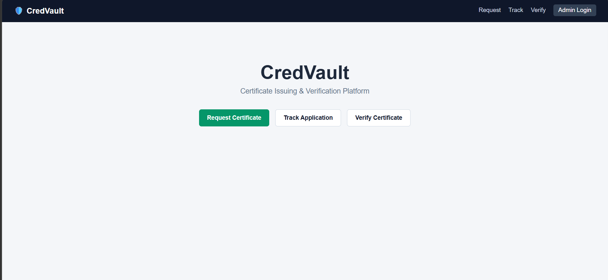
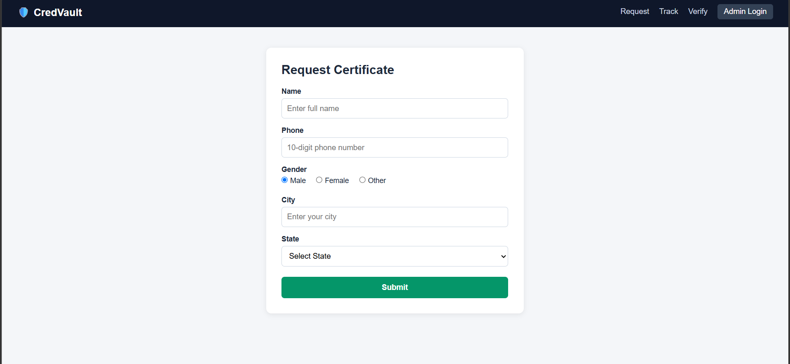
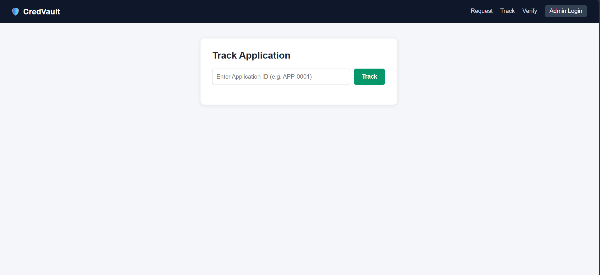
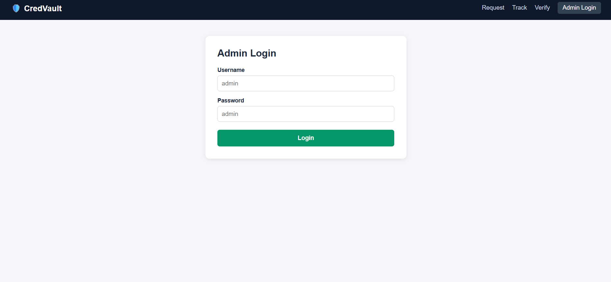
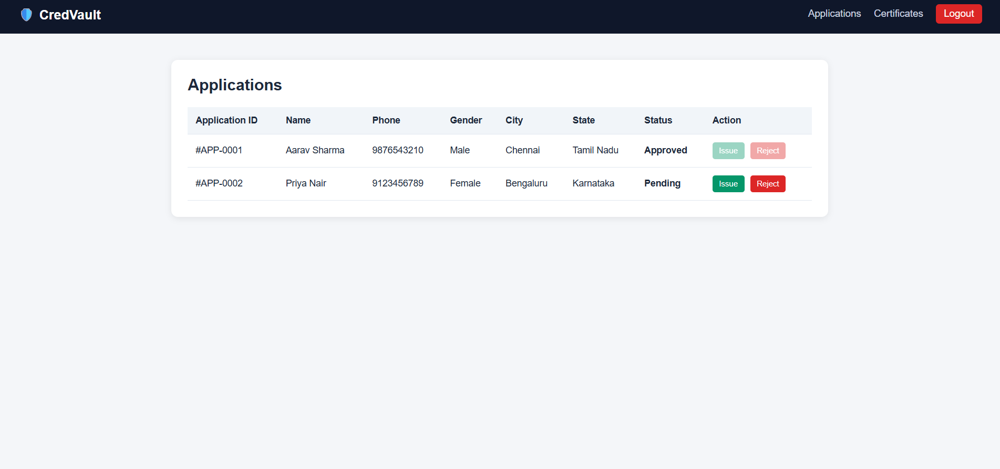
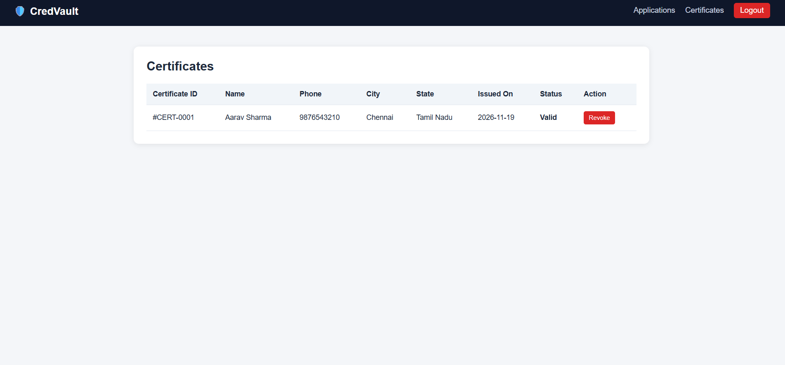

# CredVault — Certificate Issuing & Verification Platform

Frontend prototype for **CredVault** built with HTML, CSS, and JavaScript using dummy data and browser `localStorage`.

## Screenshots

### 1. Home Page

### 2. Request Certificate Page

### 3. Track Application Page

### 4. Verify Certificate Page

### 5. Admin Login Page

### 6. Admin Applications Page

### 7. Admin Certificates Page
